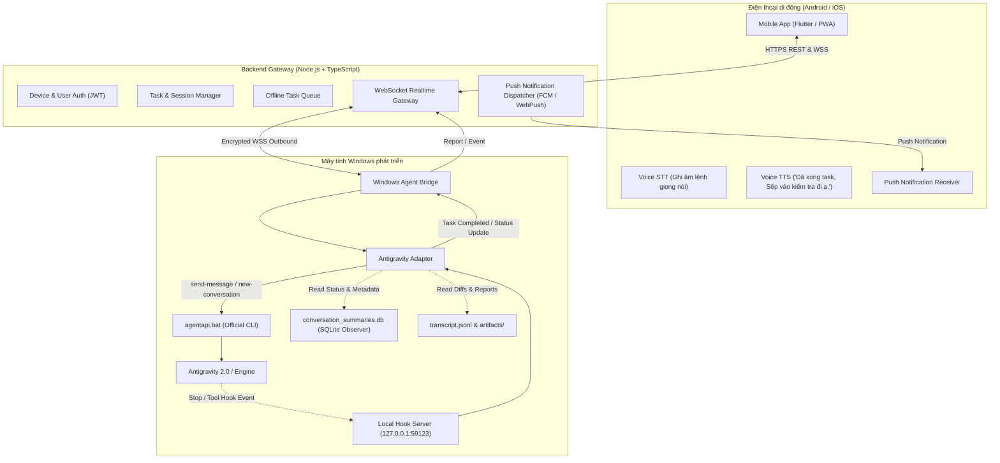

# KIẾN TRÚC HỆ THỐNG SẾP AI REMOTE

## 1. Tổng quan hệ thống

**Sếp AI Remote** là hệ thống điều khiển và giám sát AI Agent Antigravity từ thiết bị di động, tập trung vào trải nghiệm giọng nói và thông báo thời gian thực dành cho lập trình viên và nhà quản lý (Sếp).



---

## 2. Các thành phần chính

### A. Mobile App (`apps/mobile/`)
- **Công nghệ:** Flutter (Dart) hỗ trợ Android và iOS từ cùng một codebase, kèm theo Web PWA để kiểm thử trực tiếp trên trình duyệt di động.
- **Tính năng nổi bật:**
  - **Giao diện tiếng Việt chuẩn Mobile-first:** Tối giản, hiện đại, hỗ trợ Dark/Light mode.
  - **Voice AI:**
    - Ghi âm lệnh giao task bằng nút micro, nhận dạng tiếng Việt, cho phép Sếp xem và sửa văn bản trước khi gửi.
    - Đọc phản hồi và câu thông báo mặc định bằng TTS tiếng Việt tự nhiên: *“Đã xong task, Sếp vào kiểm tra đi ạ.”*
  - **Giám sát trạng thái:** Báo trạng thái PC Online/Offline rõ ràng, danh sách task, tiến độ, diff, lỗi và kết quả kiểm thử.
  - **Hội thoại tiếp nối:** Chat trực tiếp với chính agent đang mở trên PC, giữ nguyên toàn bộ lịch sử và ngữ cảnh.

### B. Backend Service (`apps/backend/`)
- **Công nghệ:** Node.js, TypeScript, Express, WebSocket (`ws`), SQLite/PostgreSQL.
- **Nhiệm vụ:**
  - Xác thực thiết bị di động và máy tính Windows qua Token/Pairing Code an toàn.
  - Quản lý đồng bộ trạng thái PC, danh sách các phiên làm việc và danh sách task.
  - Quản lý hàng đợi khi máy tính offline: lưu trữ task và tự động chuyển giao khi bridge kết nối lại.
  - Xử lý chống gửi trùng (Idempotency Key), chống spam thông báo trùng lặp.
  - Gửi Push Notification (FCM / Web Push) đến điện thoại khi có sự kiện quan trọng.
  - Cung cấp REST API và WebSocket stream cho Mobile App.

### C. Windows Agent Bridge (`apps/windows-bridge/`)
- **Công nghệ:** Node.js, TypeScript, chạy nền dưới dạng service hoặc tiện ích khởi động cùng máy tính.
- **Cơ chế an toàn:** Chủ động kết nối outbound WSS tới Backend (không cần mở cổng port-forwarding inbound trên router).
- **Phân tách module nội bộ:**
  - `AgentBridge`: Quản lý kết nối WebSocket, heartbeat, pairing và điều phối hàng đợi.
  - `AntigravityAdapter`: Giao diện trừu tượng hóa tương tác với Antigravity.
  - `TaskQueue`: Lưu tạm task, xác thực tính toàn vẹn, bảo đảm không lặp lại lệnh.
  - `HookServer`: Endpoint nội bộ nhẹ tiếp nhận sự kiện từ Antigravity Lifecycle Hooks.

### D. Antigravity Adapter (`AntigravityAdapter`)
Interface chuẩn hóa độc lập:
```typescript
interface IAntigravityAdapter {
  getConnectionStatus(): Promise<BridgeConnectionStatus>;
  getAvailableSessions(): Promise<AgentSessionSummary[]>;
  sendMessageToSession(sessionId: string, message: string, title?: string): Promise<ActionResult>;
  createNewSession(prompt: string, title?: string, model?: 'flash_lite' | 'flash' | 'pro'): Promise<ActionResult>;
  getTaskStatus(sessionId: string): Promise<TaskExecutionStatus>;
  getTaskReport(sessionId: string): Promise<TaskReport>;
  subscribeToTaskEvents(callback: (event: TaskEvent) => void): () => void;
}
```

---

## 3. Các kịch bản xử lý tiêu biểu

### Kịch bản 1: Hoàn thành Task & Báo động giọng nói
1. Agent Antigravity kết thúc lượt xử lý trên PC.
2. Lifecycle Hook `Stop` gửi sự kiện kèm `conversationId` và `terminationReason` về `HookServer` cục bộ của Bridge (hoặc SQLite Observer phát hiện chuyển từ `RUNNING` sang `IDLE`).
3. Bridge phân tích `transcript.jsonl` và `artifacts/` để tổng hợp `TaskReport` (các file đã sửa, kết quả chạy lệnh kiểm thử, mã lỗi nếu có).
4. Bridge gửi payload `task_completed` lên Backend qua WebSocket an toàn.
5. Backend ghi nhận trạng thái, lọc chống trùng lặp sự kiện trong vòng 3 giây, gửi Push Notification đến Mobile App.
6. Mobile App nhận Push Notification, hiển thị thông báo và phát âm thanh tiếng Việt: *“Đã xong task, Sếp vào kiểm tra đi ạ.”*

### Kịch bản 2: Giao task mới bằng giọng nói
1. Sếp bấm giữ nút micro trên điện thoại và nói: *“Em kiểm tra lỗi đăng nhập Google trong project NQD-LMS, chạy test rồi báo cáo anh.”*
2. STT chuyển đổi sang văn bản tiếng Việt và hiển thị trên màn hình để Sếp xác nhận hoặc chỉnh sửa.
3. Sếp chọn phiên làm việc (hoặc tạo phiên mới) và bấm gửi.
4. Mobile App gửi yêu cầu kèm UUID Idempotency Key tới Backend.
5. Nếu PC Online: Backend đẩy ngay xuống Bridge. Bridge gọi `agentapi.bat send-message` trực tiếp vào phiên đang mở.
6. Nếu PC Offline: Backend lưu task vào trạng thái `QUEUED_OFFLINE`, gửi thông báo cho Sếp biết máy tính đang offline và sẽ tự động chạy khi máy tính mở lại.
